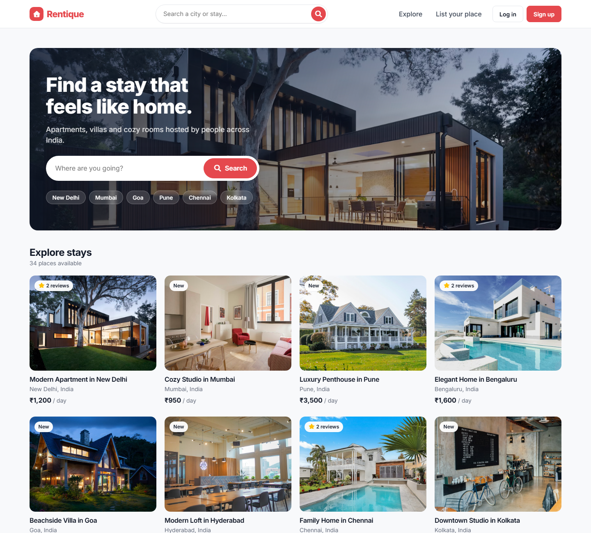
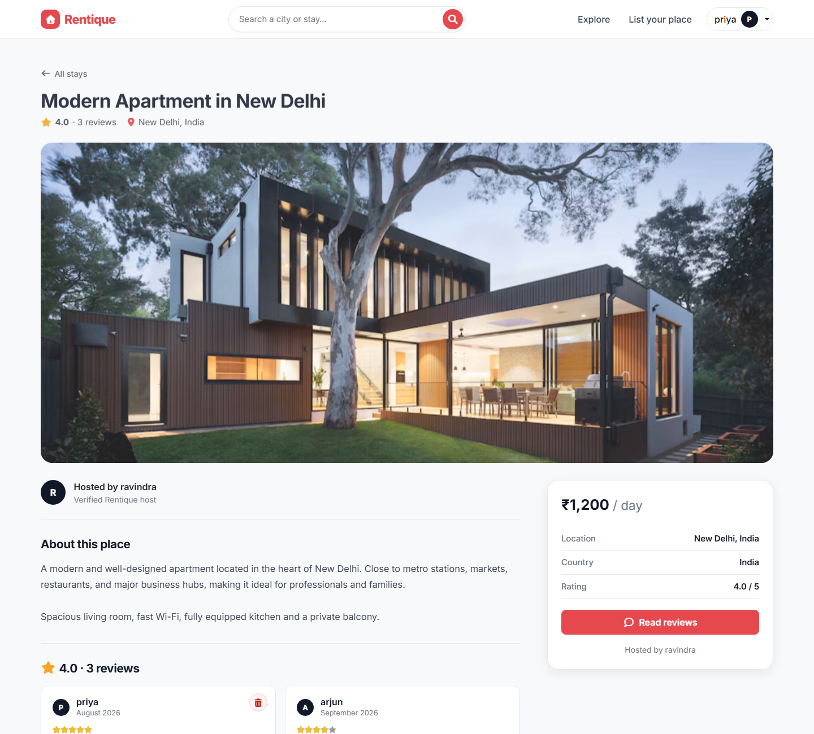
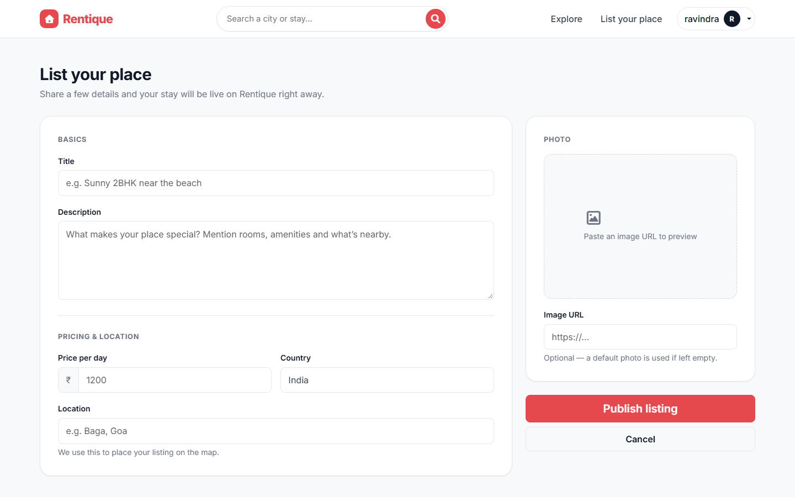
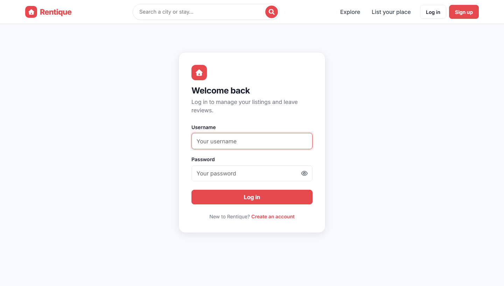

<div align="center">

# 🏠 Rentique

**Find a stay that feels like home.**

A full-stack property rental marketplace where people list their homes, villas and rooms, and guests browse, search, review and find them on a map.


</div>

---

## 📸 Screenshots

| Home | Listing details |
| :--: | :--: |
|  |  |
| **Create a listing** | **Log in** |
|  |  |

---

## ✨ Features

- **Browse & search stays**: a responsive grid of listings, plus search by city, title or country.
- **Listing details**: a large photo, description, price card, average rating and an interactive map.
- **Create, edit & delete listings**: with live image preview and form validation.
- **Automatic geocoding**: a typed location (e.g. *"Baga, Goa"*) is turned into map coordinates using OpenStreetMap Nominatim.
- **Reviews & star ratings**: one review per user per listing, with authors able to delete their own.
- **Authentication**: sign up, log in and log out with Passport (local strategy), and sessions stored in MongoDB.
- **Authorization**: only the owner can edit or delete a listing, and only the author can delete a review. An optional **super admin** can moderate everything.
- **Fair-use limit**: each user can publish up to **2 listings**.
- **Validation everywhere**: Bootstrap validation in the browser and Joi schemas on the server.
- **Friendly errors**: flash messages, a custom 404 page and safe error handling.

---

## 🧰 Tech stack

| Layer | Technology |
| --- | --- |
| Runtime | Node.js 24 |
| Server | Express 5, `method-override`, `connect-flash` |
| Views | EJS + `ejs-mate` layouts |
| Styling | Bootstrap 5.3, custom CSS design tokens, Inter font, Font Awesome 7 |
| Database | MongoDB (Atlas or local) with Mongoose 9 |
| Auth | Passport, `passport-local`, `passport-local-mongoose` |
| Sessions | `express-session` + `connect-mongo` |
| Validation | Joi (server), Bootstrap validation (client) |
| Maps | Leaflet + OpenStreetMap tiles, Nominatim geocoding (via `axios`) |
| Ratings | Starability CSS |

---

## 🚀 Getting started

### Prerequisites

- [Node.js](https://nodejs.org/) **v24+**
- A MongoDB database: either a free [MongoDB Atlas](https://www.mongodb.com/atlas) cluster or a local `mongod`

### 1. Clone and install

```bash
git clone https://github.com/Ravindra-builds/Rentique.git
cd Rentique
npm install
```

### 2. Configure environment variables

Copy the example file and fill in your values:

```bash
cp .env.example .env
```

| Variable | Required | Description |
| --- | :--: | --- |
| `ATLASDB_URL` | ✅ | MongoDB connection string (Atlas or `mongodb://127.0.0.1:27017/rentique`) |
| `SECRET` | ✅ | Long random string used to sign and encrypt session cookies |
| `PORT` | ➖ | Port the server listens on (default `8080`) |
| `ADMIN_ID` | ➖ | `_id` of a user who can edit or delete **any** listing or review |
| `SEED_OWNER_ID` | ➖ | `_id` of the user who will own the sample listings (used by `npm run seed`) |

### 3. Run the app

```bash
npm run dev     # restarts automatically on file changes
# or
npm start
```

Open **http://localhost:8080** in your browser.

### 4. (Optional) Load sample listings

1. Sign up for an account in the app.
2. Find your user's `_id` in the `users` collection (MongoDB Atlas or Compass) and put it in `.env` as `SEED_OWNER_ID`.
3. Run:

```bash
npm run seed
```

This inserts about 30 sample stays across Indian cities, with photos and map coordinates.

---

## 🗂️ Project structure

```
Rentique/
├── app.js                 # App entry: config, sessions, passport, routes, error handling
├── middleware.js          # isLoggedIn, isOwner, isAuthor, validation middleware
├── Schema.js              # Joi validation schemas for listings and reviews
├── controller/            # Route handlers (MVC "C")
│   ├── listing.js
│   ├── review.js
│   └── user.js
├── models/                # Mongoose models (MVC "M")
│   ├── listings.js        # Listing + GeoJSON point, cascades review deletion
│   ├── reviews.js
│   └── user.js            # passport-local-mongoose user
├── routes/                # Express routers
│   ├── listing.js
│   ├── review.js
│   └── user.js
├── utils/
│   ├── ExpressError.js    # Error class with HTTP status
│   ├── geocode.js         # Location → [lng, lat] via OpenStreetMap Nominatim
│   └── wrapAsync.js       # Forwards async errors to the error handler
├── views/                 # EJS templates (MVC "V")
│   ├── layouts/boilerplate.ejs
│   ├── includes/          # navbar, footer, flash, shared listing form
│   ├── listings/          # index, show, new, edit
│   ├── user/              # login, signup
│   └── error.ejs
├── public/
│   ├── css/style.css      # Design tokens + all custom styles
│   ├── css/rating.css     # Starability star ratings
│   └── script.js          # Form validation, image preview, map, confirmations
└── init/                  # Sample data + seed script
```

---

## 🛣️ Routes

| Method | Path | Auth | Description |
| --- | --- | :--: | --- |
| `GET` | `/` | — | Redirects to `/listings` |
| `GET` | `/listings` | — | All listings |
| `GET` | `/search?search=goa` | — | Search by title, location or country |
| `GET` | `/listings/new` | 🔒 | New listing form (limit: 2 per user) |
| `POST` | `/listings` | 🔒 | Create a listing (geocodes the location) |
| `GET` | `/listings/:id` | — | Listing details, reviews and map |
| `GET` | `/listings/:id/edit` | 🔒 owner/admin | Edit form |
| `PUT` | `/listings/:id` | 🔒 owner/admin | Update a listing (re-geocodes if the location changed) |
| `DELETE` | `/listings/:id` | 🔒 owner/admin | Delete a listing and its reviews |
| `POST` | `/listings/:id/reviews` | 🔒 | Add a review |
| `DELETE` | `/listings/:id/reviews/:reviewId` | 🔒 author/admin | Delete a review |
| `GET` / `POST` | `/signup` | — | Register |
| `GET` / `POST` | `/login` | — | Log in |
| `GET` | `/logout` | — | Log out |

---

## 🧱 Data model

```
User ──< Listing ──< Review >── User
```

- **User**: `username`, `email` (unique), and the password hash and salt managed by `passport-local-mongoose`
- **Listing**: `title`, `description`, `price`, `location`, `country`, `imageUrl`, `geometry` (GeoJSON Point, `2dsphere` index), `owner → User`, `reviews → [Review]`
- **Review**: `rating` (1–5), `comment`, `createdAt`, `author → User`

Deleting a listing also deletes its reviews (a Mongoose `findOneAndDelete` post hook).

---

## ☁️ Deployment

Rentique runs on any Node host (Render, Railway, Fly.io, a VPS and so on):

1. Create a MongoDB Atlas cluster and allow your host's IP.
2. Set `ATLASDB_URL`, `SECRET`, `NODE_ENV=production` and optionally `ADMIN_ID` in the host's environment settings.
3. Build command: `npm install`. Start command: `npm start`.

> In production `.env` is not loaded. Set the variables in your hosting dashboard instead.

---

## 🗺️ Roadmap

- [ ] Image uploads (e.g. Cloudinary) instead of image URLs
- [ ] Booking calendar and availability
- [ ] Filters for price range and property type
- [ ] User profile page with "My listings"
- [ ] Wishlist / favourites

---

## 👤 Author

**Ravindra Yadav**
[LinkedIn](https://www.linkedin.com/in/ravindra-yadav-778498390)

## 📄 License

Licensed under the ISC License.
